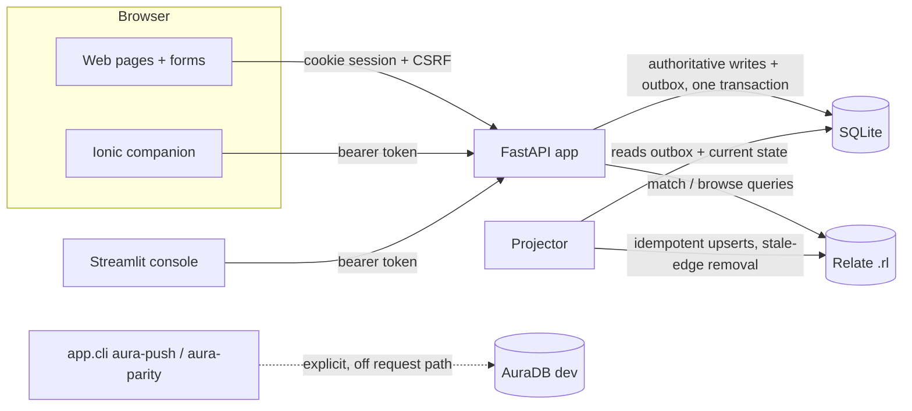

# Data Volunteer Network

**One volunteer account for helping several organisations, with graph-backed explanations of why
people and projects fit.**

A volunteer keeps one skills profile and chooses which organisations can see them. They say which
skills they have, which they offer, and which they never want to be matched on, and they can prefer
or exclude causes. A moderator vets each new volunteer before they can be matched. Active
volunteers can suggest projects to an organisation, and that organisation's admins scope and
approve them before they go live. A [Relate](https://relatedb.ai/docs/) graph decides who matches
what. Each result says which skills matched, whether the volunteer prefers the cause, and what is
still needed. When a volunteer is eligible for a project, they and the project lead are both
notified in the app, and the volunteer joins the team once both say yes.

> All people, projects and accounts in this repository are fictional. *DataKind UK* and
> *Cyber Scallywags* are used as illustrative organisation names only. Their use implies no
> endorsement or live partnership. Both names can be changed with `ORG_NAMES`.

| Surface | Tech | Local URL |
|---|---|---|
| JSON API: every action in the system | FastAPI, bearer tokens, OpenAPI docs | http://localhost:8080/api/docs |
| Web app (volunteers, project leads, org admins) | FastAPI + Jinja2, server-rendered forms, responsive | http://localhost:8080 |
| Mobile companion (matches, opportunities, notifications, profile, suggestion status) | Ionic + Angular, JSON API only | http://localhost:8100 (Compose) |
| Admin console (screening, org management, users and roles, projection, graph) | Streamlit, JSON API only | http://localhost:8501 |
| Matching graph | Relate 1.0.1, embedded single-file `.rl` store | `data/demo.rl` (bundled, read-only) |
| Transactional store | SQLite (WAL) | `var/dvn.sqlite3` (runtime, ignored) |

## Contents

- [Clean start with uv](#clean-start-with-uv)
- [Clean start with Docker Compose](#clean-start-with-docker-compose)
- [Demo accounts and walkthrough](#demo-accounts)
- [Roles and onboarding](#roles-and-onboarding)
- [The API](#the-api)
- [Inspect the bundled graph](#inspect-the-bundled-graph)
- [How are you using Relate, and why?](#how-are-you-using-relate-and-why)
- [Matching rules](#matching-rules)
- [Architecture](#architecture)
- [Security and privacy](#security-and-privacy)
- [Optional AuraDB](#optional-auradb)
- [Tests](#tests)
- [Reuse, AI assistance and licences](#reuse-ai-assistance-and-licences)

## Clean start with uv

You need [uv](https://docs.astral.sh/uv/). uv installs Python 3.14 if it is missing. The Relate
engine comes from the locked `relate-db==1.0.1` wheel, so the
[Relate CLI](https://relatedb.ai/docs/get-started/install/) is needed only for the optional
`relate ...` inspection commands.

```sh
git clone <this repository> && cd <repository>
uv sync --locked                 # Python 3.14 env from uv.lock
uv run task reset                # disposable demo: var/dvn.sqlite3 + writable copy of data/demo.rl
uv run task web                  # http://localhost:8080
```

On its first start, `task web` seeds the demo itself if `var/` is empty, so `task reset` is
optional the first time. Run `task reset` again whenever you want the demo back to its starting
state. It deletes only `var/dvn.sqlite3` and `var/graph.rl`, and it refuses to run when
`APP_ENV=production`.

To run the admin console as well:

```sh
uv sync --locked --group admin
uv run task admin                # http://localhost:8501; sign in as sam@, mo@, kofi@ or rhiannon@
```

## Clean start with Docker Compose

```sh
docker compose up -d --build --wait     # or: uv run task up
# web http://localhost:8080 · mobile http://localhost:8100 · admin http://localhost:8501
docker compose exec web python -m app.cli inspect
docker compose down -v                  # removes the demo volume
```

If those ports are already in use, run
`WEB_PORT=18080 ADMIN_PORT=18501 MOBILE_PORT=18100 docker compose up -d --build --wait`.
The web container copies the bundled `data/demo.rl` into the `dvn-data` volume on its first start
and seeds the demo accounts. The admin container shares that volume. The mobile image runs the
Ionic lint and unit tests while it builds. Its nginx then proxies `/api/` to the web app.

## Demo accounts

Every demo account uses the password **`demo-password-1`**. These accounts exist only in the
disposable local demo. They are seeded by `reset` or by a first start with `APP_ENV=test`, and
never when `APP_ENV=production`.

| Email | Role | Volunteers with | Shows |
|---|---|---|---|
| `sam@demo.invalid` | **System admin** | — | access to everything: users and roles, every organisation, projection, graph |
| `mo@demo.invalid` | **Moderator** | — | the volunteer screening queue |
| `rhiannon@demo.invalid` | **Org admin**, DataKind UK | — | the right reviewer for the pending suggestion; manages DataKind UK volunteers |
| `kofi@demo.invalid` | **Org admin**, Cyber Scallywags | DataKind UK | admin in one organisation and volunteer in another |
| `nia@demo.invalid` | volunteer, **in screening** | Cyber Scallywags | not matchable until vetted; her first aid fills a gap once Mo approves her |
| `asha@demo.invalid` | volunteer; lead of Winter Outreach Kitchen | DataKind UK, Cyber Scallywags | one profile across two organisations; author of the pending suggestion |
| `bryn@demo.invalid` | volunteer | Cyber Scallywags | already on the Winter Outreach team; author of a rejected suggestion |
| `cerys@demo.invalid` | volunteer; lead of Food Bank Demand Dashboard | DataKind UK | no cause preference, so matched on skills alone |
| `gwen@demo.invalid` | volunteer | Cyber Scallywags | a hard exclusion: offers cooking and driving but excludes *active listening* |
| `dev@demo.invalid`, `farah@demo.invalid` | volunteers | DataKind UK | preferred-cause ranking; Farah's first aid is outside Cyber Scallywags |

The fixture (`data/fixtures/demo.json`) contains two organisations with separate org admins, a
system admin, a moderator, a volunteer in screening, a volunteer in both organisations, a formed
team, overlapping project skills, one hard exclusion (Gwen), one unfilled skill
(*First aid* for Winter Outreach Kitchen), one approved project per organisation, one suggestion
awaiting review (*Outreach Data Audit*) and one rejected suggestion.

Walkthrough (also in [docs/demo-script.md](docs/demo-script.md)):

1. Sign in as **Asha** and switch between DataKind UK and Cyber Scallywags with the header
   switcher. Switching does not sign you in again, and it is a separate action from joining.
2. *My suggestions* shows **Outreach Data Audit** as *Submitted*.
3. Sign in as **Kofi**. He is org admin for Cyber Scallywags, so the DataKind UK review queue
   gives him a 403 and the suggestion gives him a 404.
4. Sign in as **Rhiannon**, open the suggestion and choose *Approve and activate*. The approval
   records her name, the revision and the time. It is projected to Relate and appears under
   *Projects*. Its author is notified at each step.
5. As Rhiannon, open the project. Candidates are listed per required skill, and coverage is
   shown.
6. As **Asha**, open *Profile* and set *Active listening* to **Exclude**. Asha disappears from
   Winter Outreach Kitchen and Outreach Data Audit, and her *My matches* page explains why. In
   Rhiannon's view, Outreach Data Audit now shows a coverage gap for *Active listening*. As Kofi,
   Cyber Scallywags' coverage shows gaps for *Active listening* and *Community cooking*, because
   Gwen, the other cook, also excludes active listening, as well as the existing *First aid* gap.
7. In the admin console, sign in as **Mo** and approve **Nia** from *Volunteer screening*. Nia is
   notified that she is active. Relate now finds her eligible for Winter Outreach Kitchen, so the
   *First aid* gap closes, and both Nia and the project lead, Asha, are notified. Nia says yes on
   *Opportunities* (web or mobile) and Asha accepts on the project page. Nia is now on the team,
   which is stored in Relate as `(:Volunteer)-[:ON_TEAM]->(:Project)`.

## Roles and onboarding

| Role | Scope | Can |
|---|---|---|
| System `admin` | everything | everything below, in every organisation; grant and revoke all roles; create organisations; projection replay; graph overview; see emails |
| System `moderator` | all volunteers | the screening queue: approve, request more information, decline, suspend, reinstate (never their own account) |
| `org_admin` | one organisation | review its project suggestions; withdraw projects and reassign project leads; list and remove its volunteers; accept or decline candidates for any of its projects |
| `reviewer` | one organisation | review its project suggestions |
| Project lead | one project (the author by default) | accept or decline candidates; remove team members |
| Volunteer | themselves | profile, joining organisations, submitting for vetting, answering offers, leaving teams, suggesting projects once active |

Roles come only from the seed, a system admin (API or console) or `python -m app.cli
grant-reviewer`. Signup never grants a role. Every check happens on the server, against the
organisation or project named in the request.

**Volunteer onboarding.** A volunteer fills in the profile form, then *Submit for vetting* moves
them from `draft` to `screening`, and moderators are notified. A moderator then sets one of:
`active`, `info_requested` (the volunteer adds detail and resubmits), `declined`, or later
`suspended` (which can be reinstated). Only `active` volunteers get `VOLUNTEERS_WITH` edges in
Relate, so the graph itself makes sure no one is matched before they have been vetted.

Once a volunteer is active, the projector asks Relate after each graph update which volunteers
match which active projects (the same matching query as everywhere else). For each new pair, the
volunteer and the project lead are notified in the app that the volunteer is eligible. When both
say yes, the volunteer is on the team, and Relate records an `ON_TEAM` edge. A no from either side
declines the pair. A pair that stops matching before both said yes lapses, and it revives if it
matches again.

**Project onboarding:** *In review* → (*Scoping: more detail requested* → revised) →
*Approved (activating…)* → *Active* (visible and matching once projected to Relate), with
*Rejected* and *Withdrawn* as end states.

Every transition sends an in-app notification to the person it affects: the volunteer for vetting
and placement steps, the author for project steps, and the lead and admins for new candidates and
suggestions. The web app and the mobile app have *Notifications* and *Opportunities* pages, and
the Profile page shows the onboarding status on both.

## The API

**Every action in the system is an endpoint under `/api/v1`.** Interactive docs are at
`/api/docs`. The mobile app and the Streamlit admin console use nothing else: neither touches
SQLite or Relate directly. The server-rendered web pages call the same service functions
in-process, so roles, states and version checks are enforced in one place
(`src/app/services.py`, `src/app/placements.py`).

| Group | Endpoints |
|---|---|
| auth | `POST /auth/signup`, `POST /session`, `DELETE /session` |
| me | `GET /me`, `PUT /me/active-org`, `GET/PUT /profile`, `POST /me/vetting`, `GET /notifications`, `POST /notifications/{id}/read`, `POST /notifications/read-all` |
| organisations | `GET /orgs`, `PUT/DELETE /orgs/{org}/membership`, `GET /orgs/{org}/matches`, `GET /orgs/{org}/projects`, `GET /orgs/{org}/coverage`, `GET /orgs/{org}/volunteers`, `POST /orgs/{org}/volunteers/{user}/remove` |
| projects | `GET/POST /submissions`, `GET /submissions/{id}`, `POST /submissions/{id}/revisions`, `GET /orgs/{org}/submissions`, `POST /orgs/{org}/submissions/{id}/decision`, `POST /orgs/{org}/projects/{id}/withdraw`, `PUT /orgs/{org}/projects/{id}/lead` |
| placements | `GET /placements`, `POST /placements/{project}/answer`, `POST /placements/{project}/leave`, `GET /projects/{project}/placements`, `POST /projects/{project}/placements/{volunteer}/answer`, `POST /projects/{project}/placements/{volunteer}/remove` |
| moderation | `GET /moderation/volunteers?status=`, `GET /moderation/volunteers/{user}`, `POST /moderation/volunteers/{user}/decision` |
| admin | `GET /admin/users`, `PUT/DELETE /admin/users/{user}/system-roles/{role}`, `PUT/DELETE /admin/orgs/{org}/roles/{user}/{role}`, `POST /admin/orgs`, `GET /admin/projection`, `POST /admin/projection/replay`, `GET /admin/graph` |

```sh
TOKEN=$(curl -s -X POST localhost:8080/api/v1/session -H 'content-type: application/json' \
  -d '{"email":"mo@demo.invalid","password":"demo-password-1"}' | python3 -c 'import sys,json;print(json.load(sys.stdin)["token"])')
curl -s localhost:8080/api/v1/moderation/volunteers -H "Authorization: Bearer $TOKEN"
```

Errors are JSON: 401 signed out, 403 role missing, 404 unknown or not visible to you, 409 stale
`version` or wrong state, 422 invalid input.

## Inspect the bundled graph

`data/demo.rl` is a real single-file Relate store, committed read-only and rebuilt from
`data/fixtures` by `uv run task bundle`. A test fails if the committed file drifts from what the
fixtures rebuild to.

```sh
uv run task inspect                     # = python -m app.cli inspect --store data/demo.rl
```

Expected output (volunteer IDs are opaque in the graph; the CLI labels known demo IDs):

```text
organisation     | project                    | cause         | skill                         | eligible_volunteers
-----------------+----------------------------+---------------+-------------------------------+------------------------------------------------------------------------------
Cyber Scallywags | Winter Outreach Kitchen    | Homelessness  | Active listening              | Asha (u_8d06f6350514542f)
Cyber Scallywags | Winter Outreach Kitchen    | Homelessness  | Community cooking             | Asha (u_8d06f6350514542f)
Cyber Scallywags | Winter Outreach Kitchen    | Homelessness  | First aid                     | — coverage gap —
Cyber Scallywags | Winter Outreach Kitchen    | Homelessness  | Van driving                   | Bryn (u_b2fc33a819a557b1)
DataKind UK      | Food Bank Demand Dashboard | Food Security | Bookkeeping                   | Cerys (u_8e53893c6dce5e79), Dev (u_9d1d1a6fd5d559ae)
DataKind UK      | Food Bank Demand Dashboard | Food Security | Spreadsheet and data analysis | Asha (u_8d06f6350514542f), Kofi (u_93069089b5f059ad), Dev (u_9d1d1a6fd5d559ae)
```

With the Relate CLI (v1.0.1) installed, you can query the same file directly:

```sh
relate --database data/demo.rl --read-only --mode table \
  "MATCH (o:Organisation)-[:OWNS_PROJECT]->(p:Project)-[:REQUIRES_SKILL]->(s:Skill)
   RETURN o.name AS organisation, p.title AS project, collect(s.name) AS required ORDER BY organisation"
relate --database data/demo.rl --read-only --mode table \
  "MATCH (n) RETURN labels(n)[0] AS label, count(n) AS nodes ORDER BY label"
```

The bundled store has 35 nodes (5 causes, 15 skills, 2 organisations, 2 projects, 11 volunteer
IDs, of which Sam and Mo have no edges and Nia, still in screening, has no membership edge) and 67
relationships, including one `ON_TEAM`. `uv run python -m app.cli matches --org datakind-uk --store data/demo.rl`
prints the ranked candidates for one organisation: Dev, Asha, Cerys, then Kofi.

The app's writable store is `var/graph.rl` (or `/data/graph.rl` in Compose). The app opens the
store per unit of work, so `relate --database var/graph.rl --read-only ...` also works while the
server is running.

## How are you using Relate, and why?

**What Relate does here.** Relate is the matching engine and the main demo graph. It stores
organisations, opaque volunteer IDs, the shared skill and cause catalogue, each volunteer's skill
offers, exclusions and cause preferences, approved projects and their requirements. One Cypher
query (`MATCH_CANDIDATES` in [src/app/graph/cypher.py](src/app/graph/cypher.py)) decides every
match by following relationships:

```text
(:Organisation)-[:OWNS_PROJECT]->(:Project)-[:SERVES_CAUSE]->(:Cause)
(:Project)-[:REQUIRES_SKILL]->(:Skill)        (:Project)-[:BENEFITS_FROM_SKILL]->(:Skill)
(:Volunteer)-[:VOLUNTEERS_WITH]->(:Organisation)          only while opted in AND vetted (active)
(:Volunteer)-[:ON_TEAM]->(:Project)                       volunteer and project lead both said yes
(:Volunteer)-[:HAS_SKILL|OFFERS_SKILL|EXCLUDES_SKILL]->(:Skill)
(:Volunteer)-[:PREFERS_CAUSE|EXCLUDES_CAUSE]->(:Cause)
```

The same query returns the explanation fields: matched required skills, matched optional skills,
remaining requirements and the preferred-cause flag. Separate queries return coverage gaps, the
volunteer's own exclusion reasons, browse results and the inspection view.

**Why a graph, and why Relate.**

- The question has the shape of a path. *Is there a path from this organisation through an
  approved project to a skill the volunteer has and offers, with no exclusion edge back to the
  project's cause or required skills?* That is a short `MATCH` with `NOT EXISTS {}`. It is not a
  set of join tables plus application code that has to agree with them.
- Explanations come with the result. The fields that justify a match come from the same
  traversal that made it, so the result and its explanation cannot disagree.
- Relate is embedded and stored in a single file. The whole graph is one `.rl` file. Judges can
  clone it, inspect it with the `relate` CLI and run the app on a writable copy. No database
  server or cloud account is needed. The Python binding (`relate-db`, PEP 249) runs in-process on
  CPython 3.14.
- The Cypher is portable. The statements use the Neo4j 5 dialect, so the optional AuraDB parity
  check runs the same query text on a cloud instance.

**Engine choice and verification.** The embedded binding `relate-db==1.0.1` (abi3 wheels for
macOS, Linux and Windows) was installed and checked on CPython 3.14.5. A write, close and reopen
check passed, and the 1.0.1 CLI read the file the binding wrote. The binding is used instead of
the earlier PoC's subprocess CLI adapter. The pin matches the tested CLI version.

**Engineering details.**

- **Single writer.** Relate locks the store exclusively for every opener, read-only openers
  included. The adapter therefore opens the store per unit of work (about 8 ms on the demo graph)
  and serialises access inside the process. If another process holds the lock, it retries a
  bounded number of times and then reports `GraphBusy`. Examples of such processes are the CLI
  or `relate --read-only`. The admin console goes through the API, so it never opens the store.
- **Safe queries.** Every value is a bound parameter. Reads are capped and raise an error rather
  than silently truncating results.
- **Relate decides, SQLite checks.** Relate makes the matching decision. SQLite is consulted only
  for access (membership and role in the target organisation), for freshness (results are
  withheld while a relevant projection is pending, and rows for projects no longer published in
  SQL are dropped) and for display names. Display names are shown only for volunteers who are
  currently opted in.

## Matching rules

Matching follows one interpretation, and the UI, these docs and
[tests/test_matching.py](tests/test_matching.py) all use it:

| Condition | Result |
|---|---|
| Volunteer opted in to the project's organisation, and the project is verified and published | The project is considered for matching |
| Project serves a cause the volunteer excluded, or requires a skill the volunteer excluded | The volunteer–project pair is excluded, even when another skill matches |
| Volunteer has **and** offers at least one required skill | They are a candidate for each eligible skill |
| Volunteer prefers the project's cause | Ranked ahead of otherwise comparable eligible matches |
| Volunteer has no cause preference | Skills-based matches are allowed for every cause they have not excluded |
| Volunteer excludes an optional skill | That skill is left out of explanations and scoring, and the pair is not excluded |
| A required skill has no eligible volunteer in that organisation | A coverage gap is shown |

Ranking is deterministic: preferred cause first, then the number of required skills covered, then
the number of optional skills offered, then stable IDs. A partial match is presented as a
contribution opportunity, with the skills still needed from others. Volunteers can turn on a
*Preferred causes only* filter. Exclusion explanations are visible only to the volunteer
concerned. Reviewers see eligible candidates and gaps.

## Architecture

The full write-up, with tools, components, data model, RBAC, workflows and decisions, is in
[docs/solution-architecture.md](docs/solution-architecture.md) (PDF:
[docs/solution-architecture.pdf](docs/solution-architecture.pdf)).



- **SQLite** holds identities, sessions, organisation memberships and roles, authoritative
  profile edits, submissions and their revisions, review history and the outbox.
- **Outbox projection** ([src/app/graph/projector.py](src/app/graph/projector.py)). Each
  state-changing request writes its change and an outbox row in the same SQLite transaction. The
  projector rebuilds that entity's graph state from the current SQLite rows inside one Relate
  transaction, then marks the row done. Failures stay queued with the error and an exponential
  backoff (capped at 60 s), and items with three or more failed attempts are flagged as failing.
  The projector runs straight after each change, in a background loop, at startup (replay after a
  restart), from `python -m app.cli drain` and from the console's *Replay outbox now* button.
  Because it reconciles to the current state, replaying an item is idempotent and the order
  items are processed in does not matter.
- **Publication** follows the states *Submitted* → *Changes requested* / *Rejected* /
  *Approved* → *Published* → *Withdrawn*. *Approved* becomes *Published* only once the approved
  revision is in Relate. Every transition checks the current state, revision and a version
  counter, so a stale or replayed form cannot publish twice.

Code map:

| Path | Purpose |
|---|---|
| `src/app/web/api.py` | the JSON API: every action, under `/api/v1` |
| `src/app/web/main.py`, `templates/` | server-rendered pages |
| `src/app/services.py` | domain operations with server-side authorisation: roles, vetting, organisations, submissions |
| `src/app/placements.py` | eligibility sweep from Relate matches, two-sided acceptance, teams |
| `src/app/notify.py` | in-app notifications, written in the same transaction as the change |
| `src/app/profile_view.py` | the Profile screen (sections, skill types, labels, active and past projects), shared by the web page and the mobile API |
| `src/app/matching.py` | access and freshness checks around Relate queries |
| `src/app/graph/` | Relate adapter, Cypher, projector and AuraDB |
| `src/app/auth.py` | Argon2id hashing and opaque sessions |
| `src/app/sqlstore.py` | SQLite schema |
| `src/app/runtime.py` | wiring and the demo seed |
| `src/app/cli.py` | operator commands |
| `src/app/admin/main.py` | Streamlit admin console (an API client) |
| `mobile/` | Ionic app |

## Security and privacy

- Passwords are hashed with Argon2id (`argon2-cffi`). Emails are normalised and unique. Sign-in
  takes the same time whether or not the email exists.
- Sessions use opaque, random, revocable tokens. Only their SHA-256 is stored. Cookies are
  `HttpOnly` and `SameSite=Lax`, and `Secure` over HTTPS (or when `COOKIE_SECURE=true` is set).
  Sign-in rotates the session.
- Every state-changing form carries a CSRF token: per session once signed in, and a
  double-submit cookie for sign-in and sign-up. The mobile API accepts only bearer tokens and
  never reads cookies.
- Roles (system admin, moderator, org admin, reviewer) are granted only by the seed, a system
  admin or `python -m app.cli grant-reviewer`. Signup ignores any posted role. New accounts start
  in `draft`; only vetted (`active`) volunteers can be matched or suggest projects. Every protected request checks access against the organisation named
  in the URL or form. Unknown or invisible records return 404, and missing roles return 403.
- Reviewers cannot decide on their own suggestions.
- The graph contains no emails, passwords, sessions or private review notes. Volunteers appear
  in it only as opaque IDs. Candidate lists show display names and matching evidence, never
  contact details. Private review notes are shown only to that organisation's reviewers.
- Responses carry a CSP without inline scripts, `X-Frame-Options: DENY`, `nosniff` and
  `no-store` on dynamic pages.
- `APP_ENV=production` disables demo seeding and refuses to start on a database that holds demo
  (`@demo.invalid`) accounts.

## Optional AuraDB

Local signup, approval and matching never need Aura credentials. AuraDB is an explicit, opt-in
destination for the synthetic graph plus a match-parity check. It uses the Neo4j Python driver and
never runs on the request path. Use a designated **dev** instance:

```sh
cp .env.example .env            # fill AURA_URI=neo4j+s://..., AURA_PASSWORD=...
uv sync --locked --group aura
uv run --env-file .env python -m app.cli aura-push     # nodes get dvn_scope="dvn-demo-v1"
uv run --env-file .env python -m app.cli aura-parity   # same MATCH_CANDIDATES text on both engines
uv run --env-file .env pytest -m aura --no-cov
```

`aura-push` deletes only nodes whose `dvn_scope` is `dvn-demo-v1`, then copies every node and
relationship from the writable Relate store. `aura-parity` compares normalised result rows for
each organisation and exits with a non-zero status on any difference. **Status: not yet run.** No
dev instance or credentials were available while this was built. See
[docs/verification.md](docs/verification.md).

## Tests

```sh
uv run task test                # pytest: temporary SQLite + real Relate stores per test
uv run task lint
docker build -f docker/mobile.Dockerfile --target test .     # Ionic lint + unit tests
COMPOSE_WEB_URL=http://localhost:8080 COMPOSE_MOBILE_URL=http://localhost:8100 \
  COMPOSE_ADMIN_URL=http://localhost:8501 uv run pytest -m compose --no-cov
```

The suite covers:

- one login across organisations, and switching versus joining
- role and tenant isolation, including forged organisation, submission and project IDs
- submission visibility, changes requested and revision, rejection, approval and withdrawal
- stale, repeated and self-approval attempts
- every row of the matching-rules table, the preferred-only filter, and profile edits propagating
  to Relate
- projection failure, withheld results, restart and replay, idempotent replay and persistence
  across restarts
- the bundled store matching a fresh build, and CLI access to it
- the mobile API, CSRF, cookie flags and the production guards
- RBAC across system admin, moderator, org admin, reviewer and project lead, including
  cross-organisation denials
- volunteer onboarding end to end (draft → screening → active → eligible → both yes → team, with
  `ON_TEAM` in Relate), info requests, suspension, lapsed and revived offers, and removals
- project onboarding notifications at each phase, JSON errors, and OpenAPI coverage of every tag

Latest results are in [docs/verification.md](docs/verification.md).

## Reuse, AI assistance and licences

See [docs/reuse-and-attribution.md](docs/reuse-and-attribution.md) for what came from the earlier
template and the earlier PoC, what was built for this entry, the AI-assistance disclosure, and the
licences of dependencies. The code is MIT ([LICENSE](LICENSE)). `brand/` is the template's CC0
neutral brand kit ([TRADEMARKS.md](TRADEMARKS.md)). Relate is distributed by its authors under
Apache-2.0 (binary).
