# Data Volunteer Network: Solution Architecture

| | |
|---|---|
| **System** | Data Volunteer Network (DVN), a hackathon build |
| **Scope** | Web app, JSON API, Ionic mobile app, Streamlit admin console, Relate graph, optional AuraDB |
| **Status** | Working build, verified locally and under Docker Compose |
| **Engines** | Python 3.14, Relate 1.0.1 (embedded `relate-db`), SQLite (WAL) |
| **Companion docs** | [README](../README.md), [verification record](verification.md), [demo script](demo-script.md), [reuse and attribution](reuse-and-attribution.md) |

---

## Contents

1. [Purpose and scope](#1-purpose-and-scope)
2. [Architecture at a glance](#2-architecture-at-a-glance)
3. [Tools and technology](#3-tools-and-technology)
4. [Logical components](#4-logical-components)
5. [Data architecture](#5-data-architecture)
6. [Security, identity and access control](#6-security-identity-and-access-control)
7. [Core workflows](#7-core-workflows)
8. [API surface](#8-api-surface)
9. [Functions by module](#9-functions-by-module)
10. [Deployment and operations](#10-deployment-and-operations)
11. [Quality and verification](#11-quality-and-verification)
12. [Architecture decisions](#12-architecture-decisions)
13. [Limitations and next steps](#13-limitations-and-next-steps)

---

## 1. Purpose and scope

The Data Volunteer Network matches **vetted volunteers** with **approved projects** run by
partner organisations. It suggests a match when a volunteer has and offers the skills a project
needs, and never when the project touches a cause or skill the volunteer has excluded. The
illustrative organisations, *DataKind UK* and *Cyber Scallywags*, can be renamed with
`ORG_NAMES`; no endorsement is implied.

The solution covers:

- **Identity:** signup, sign-in and sign-out, with server-side authorisation on every action.
- **Volunteer onboarding:** profile, then vetting by a moderator, then active, then matched,
  then on a team.
- **Project onboarding:** a suggestion is reviewed by the organisation, may be sent back for
  scoping, and is then approved and made active.
- **Matching** on a graph engine (Relate), with explainable results and coverage gaps.
- **Three clients** on one backend: server-rendered web pages, an Ionic mobile app and a
  Streamlit admin console.
- **In-app notifications** at every state change.
- **Optional AuraDB** push and parity check, run only on request.

**Out of scope:** email and SMS delivery, production hosting, single sign-on, and publishing to
app stores.

---

## 2. Architecture at a glance

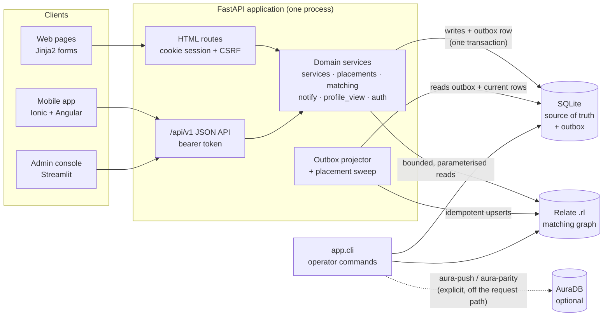

**Design principles**

1. **SQLite is the source of truth; Relate is a derived read model.** Every change is written to
   SQLite with an outbox row in the same transaction. The graph is rebuilt from that state.
2. **The graph holds no personal data.** Volunteers appear as opaque IDs only: no names, emails,
   sessions or review notes.
3. **Every action is a FastAPI endpoint.** The mobile app and the admin console use only
   `/api/v1`. The web pages call the same service functions in-process.
4. **Authorise on the server, every time.** Clients only hide what they can't use; the API
   checks again on every call.
5. **Don't show a stale answer.** When a relevant graph update is still pending, results are
   withheld and the user is told why, rather than shown out-of-date matches.

---

## 3. Tools and technology

### 3.1 Runtime stack

| Layer | Tool | Version | Role |
|---|---|---|---|
| Language | CPython | 3.14 | Application runtime |
| Packaging | uv + `uv.lock` | latest | Reproducible environments, task runner via taskipy |
| Web framework | FastAPI | 0.162 | JSON API, HTML routes, OpenAPI docs at `/api/docs` |
| ASGI server | Uvicorn | 0.54 | HTTP server (`python -m app.serve web`) |
| Templates | Jinja2 | 3.1 | Server-rendered pages, no client JavaScript needed |
| Forms | python-multipart | locked | Form parsing |
| Config | pydantic-settings | 2.16 | Typed settings from env and `.env` |
| Passwords | argon2-cffi | 25.1 | Argon2id hashing |
| Graph engine | **Relate** (`relate-db`) | **1.0.1** | Embedded, single-file `.rl` graph; Cypher; PEP 249 driver |
| Transactional store | SQLite (stdlib) | bundled | WAL mode, `BEGIN IMMEDIATE`, schema version 2 |
| Optional graph | Neo4j Python driver → AuraDB | 6.4 | `aura-push` and `aura-parity` only |
| Admin console | Streamlit + httpx + pandas | 1.67 / 0.28 / 3.1 | Staff UI, a client of the JSON API only |

### 3.2 Mobile stack

| Tool | Version | Role |
|---|---|---|
| Angular | 22.2 | Standalone components, signals, functional guards and interceptors |
| Ionic | 9 | Mobile UI components (accordions, lists, menu, badges) |
| Capacitor | 8.5 | Native shell (optional, for packaging later) |
| TypeScript | 6.0 | Language |
| Vitest | 5.0 | Unit tests (25 tests in 10 spec files) |
| nginx | stable | Serves the built app and proxies `/api/` to the web service in Compose |

### 3.3 Engineering tooling

| Tool | Use |
|---|---|
| pytest 9 + coverage | 81 backend tests, 89% line coverage; `aura` and `compose` markers for gated tests |
| Streamlit `AppTest` | Headless tests of the admin console for each role |
| Ruff 0.17 | Lint and format (line length 100) |
| ESLint + Angular CLI | Mobile lint and production build |
| Docker + Docker Compose | Two-command clean start: services `web`, `admin`, `mobile`; volume `dvn-data` |
| GitHub Actions | CI: Python lint and tests, lockfile check, mobile lint and tests (in Docker), Compose smoke test |
| pre-commit | Local lint hooks |
| Relate CLI 1.0.1 | Optional inspection of the same `.rl` files (`relate ...`) |

### 3.4 Why Relate

- **Embedded and single-file.** It needs no server and is opened in-process. A demo graph
  (`data/demo.rl`) is bundled with the package and copied for each reset.
- **Cypher.** Matching rules read naturally as patterns: `EXISTS {}` exclusions, scoped
  `CALL (p) {}` subqueries and `UNWIND` upserts. The same text runs on AuraDB, which is what makes
  the parity check possible.
- **Persistent.** Data survives a restart, and the tests reopen the store to prove it.
- **Constraint handled:** Relate locks the store exclusively, even for reads. The adapter
  therefore opens one connection per unit of work (about 8 ms), serialises access with a
  per-path lock and retries a bounded number of times before raising `GraphBusy` (a 503 response).

---

## 4. Logical components

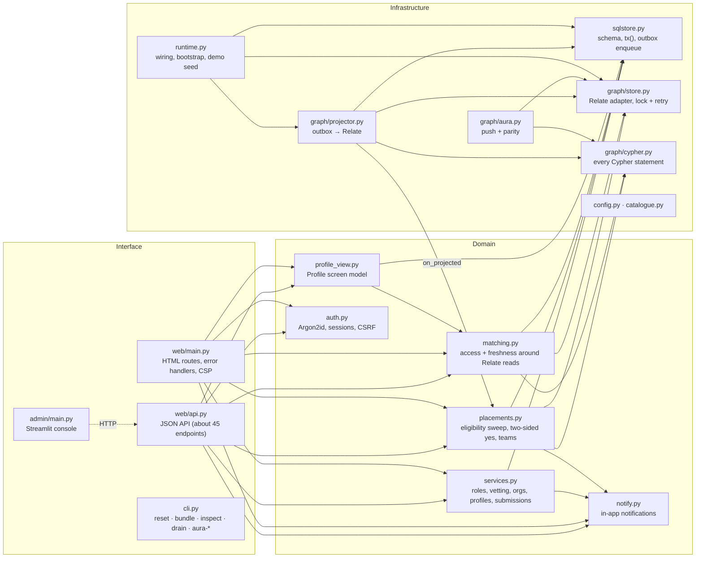

| Component | Responsibility | Size (lines) |
|---|---|---|
| `web/api.py` | Every action as a typed JSON endpoint, grouped by tag | 597 |
| `web/main.py` | App factory, HTML pages, CSP, JSON error mapping, docs mount | 759 |
| `services.py` | Domain operations and **all authorisation decisions** | 896 |
| `placements.py` | Onboarding step 2: eligible, then both say yes, then on the team | 275 |
| `matching.py` | Org access, account status, pending-update withholding, explanations | 261 |
| `graph/projector.py` | Outbox drain, reconcile per entity, backoff, hook into the sweep | 304 |
| `graph/cypher.py` | All Cypher, with fixed labels and parameter-bound values | 270 |
| `graph/store.py` | Relate connection per unit of work, lock, retry, row cap | 131 |
| `sqlstore.py` | Schema (18 tables), transactions, outbox enqueue | 288 |
| `auth.py` | Argon2id, opaque sessions, CSRF comparison | 152 |
| `admin/main.py` | Role-based staff console over the API | 262 |
| `mobile/src/app` | Ionic pages: sign-in, matches, suggestions, profile, opportunities, notifications | n/a |

---

## 5. Data architecture

### 5.1 Responsibilities of each store

| Concern | SQLite | Relate | AuraDB |
|---|---|---|---|
| Accounts, password hashes, sessions | ✔ | ✘ | ✘ |
| Roles, vetting history, review notes | ✔ | ✘ | ✘ |
| Profiles (skills, causes, memberships) | ✔ authoritative | ✔ projected (IDs only) | copy on push |
| Submissions and revisions | ✔ authoritative | ✔ active projects only | copy on push |
| Placements and teams | ✔ authoritative | ✔ `ON_TEAM` edges | copy on push |
| Notifications | ✔ | ✘ | ✘ |
| Matching and coverage queries | ✘ | ✔ | parity check only |

### 5.2 Relational model (SQLite, schema version 2)

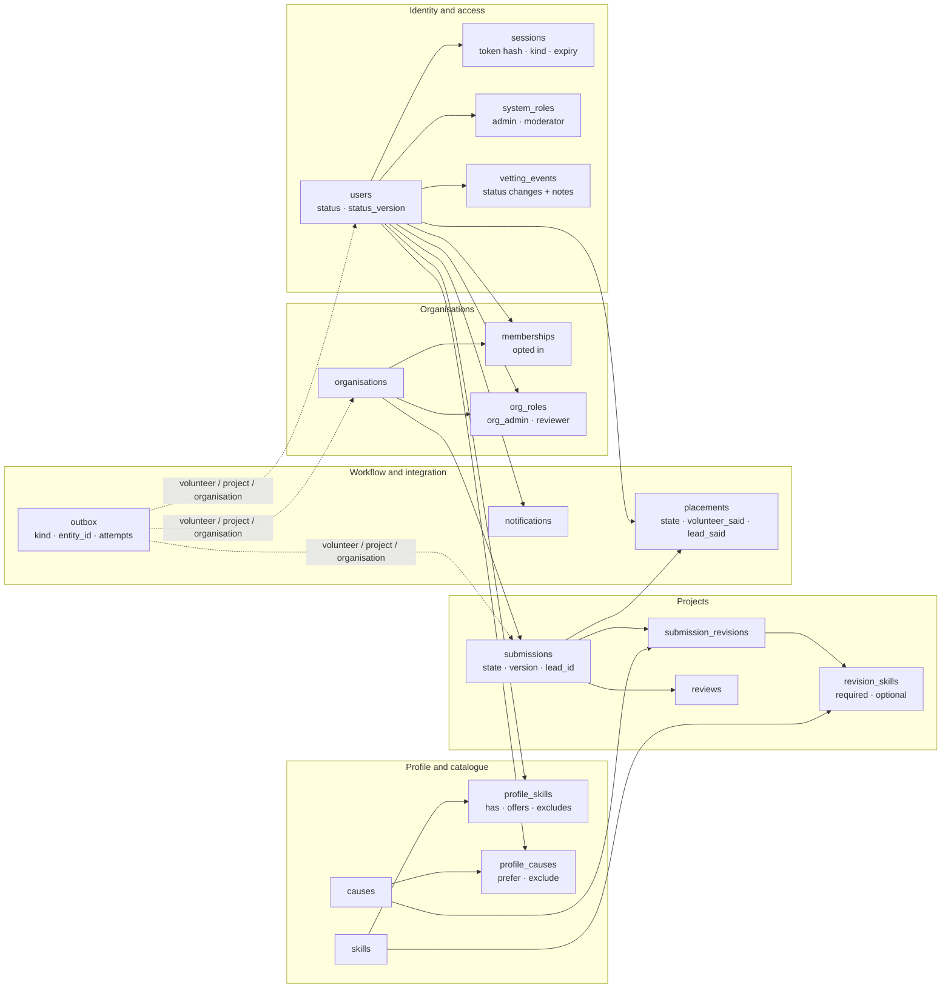

Key columns:

- **`users`:** `status` (draft, screening, info_requested, active, declined, suspended),
  `status_version`, `profile_version`, `vetted_by`, `vetted_at`.
- **`submissions`:** `state`, `current_revision`, `version`, `lead_id` (the author by default).
- **`placements`:** `state` (eligible, team, declined, lapsed, removed, left), `volunteer_said`,
  `lead_said`, `matched_skills`, `version`.
- **`outbox`:** `kind`, `entity_id`, `attempts`, `next_attempt_at`, `last_error`, `done_at`.

### 5.3 Graph model (Relate)

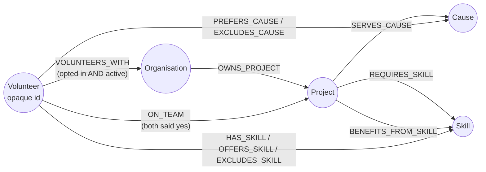

The bundled demo graph has **35 nodes and 67 relationships**: 2 organisations, 5 causes,
15 skills, 2 active projects and 11 volunteer IDs.

### 5.4 Matching rules (implemented in Cypher)

| Condition | Result |
|---|---|
| Volunteer opted in to the project's organisation **and** is active; the project is active | The pair is considered |
| Project serves a cause the volunteer excluded, or requires a skill they excluded | The pair is **excluded**, even if another skill matches |
| Volunteer has **and** offers at least one required skill | They are a candidate |
| Volunteer prefers the project's cause | Ranked first |
| Volunteer excludes an optional skill | That skill is left out of scoring; the pair stays |
| A required skill has no eligible volunteer in the organisation | A **coverage gap** is shown |

Ranking is deterministic: preferred cause first, then required skills covered, then optional
skills offered, then stable IDs. Reads are capped at `GRAPH_MAX_ROWS` (500 by default); hitting
the cap raises `GraphTruncated` rather than silently returning partial results.

---

## 6. Security, identity and access control

### 6.1 Identity

| Control | Implementation |
|---|---|
| Password storage | Argon2id; equal-time checks for unknown emails |
| Web sessions | Opaque random token in an HttpOnly, SameSite=Lax cookie (Secure over HTTPS); only its SHA-256 is stored; revocable; 12 h TTL |
| API sessions | Bearer tokens of a separate session kind; no cookies, so CSRF does not apply |
| CSRF | A token per session for signed-in forms, and a double-submit cookie for anonymous forms |
| Headers | Strict CSP on pages, with a narrow relaxation for `/api/docs` only |
| Concurrency | Optimistic versions on profiles, statuses, submissions and placements, so stale writes get 409 |
| Graph privacy | No PII in Relate or AuraDB; volunteers are uuid5 opaque IDs |
| Production guards | Demo seeding refuses `APP_ENV=production`; the app refuses to start on a DB holding `@demo.invalid` accounts |

### 6.2 Roles (RBAC)

| Role | Scope | Granted by | Can |
|---|---|---|---|
| **System admin** | All organisations | Another admin, or the seed | Everything: users, roles, organisations, projection health, the graph, emails |
| **Moderator** | System | System admin | Vet volunteers: approve, request info, decline, suspend, reinstate (never themselves) |
| **Org admin** | Their organisation | System admin | Review and withdraw projects, reassign leads, list and remove volunteers, answer candidates |
| **Reviewer** | Their organisation | System admin | Review suggestions, withdraw active projects |
| **Project lead** | One project | Author by default; reassigned by an org admin | Accept or decline candidates, remove team members |
| **Volunteer** | Self | Signup | Edit profile, join organisations, suggest projects, answer offers, leave teams |

Signup never grants a role. Authorisation is resolved by `services.org_access`, which returns an
`Access` record (volunteer, reviewer, org_admin, system_admin), and enforced by
`require_access(role=…)` and `require_active`. A refused organisation action returns **403**
with a plain-language reason. A project, submission or placement the user can't see returns
**404**, so the API doesn't confirm that it exists.

### 6.3 Permission matrix (selected actions)

| Action | Volunteer | Lead | Reviewer | Org admin | Moderator | System admin |
|---|:-:|:-:|:-:|:-:|:-:|:-:|
| Edit own profile, submit for vetting | ✔ | ✔ | ✔ | ✔ | ✔ | ✔ |
| Suggest a project (active account) | ✔ | ✔ | ✔ | ✔ | ✔ | ✔ |
| Review a suggestion | | | own org | own org | | ✔ |
| Withdraw an approved or active project | | | own org | own org | | ✔ |
| Reassign a project lead | | | | own org | | ✔ |
| Answer a candidate, remove from a team | | own project | | own org | | ✔ |
| List or remove organisation volunteers | | | | own org | | ✔ |
| Vet volunteers | | | | | ✔ | ✔ |
| Grant roles, create organisations, replay the outbox | | | | | | ✔ |

---

## 7. Core workflows

### 7.1 Write path: transaction, outbox and projection

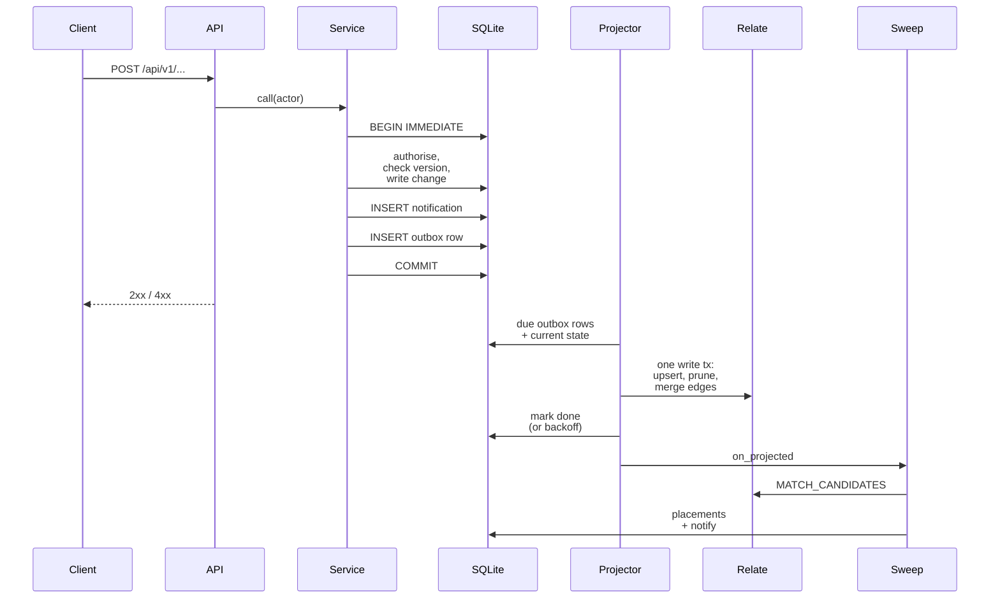

- **Idempotent:** each item reconciles to the *current* state, so replays and reordering are safe.
- **Resilient:** a failure stays queued with exponential backoff (capped at 60 s), is flagged
  after 3 attempts and is replayed at startup or from the console.
- **Fresh:** while a relevant item is pending, `matching.py` returns `Withheld` with a reason.

### 7.2 Read path: matches and coverage

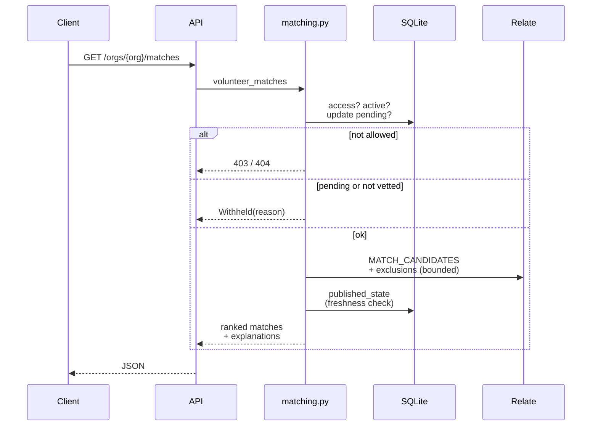

### 7.3 Volunteer onboarding, step 1: vetting

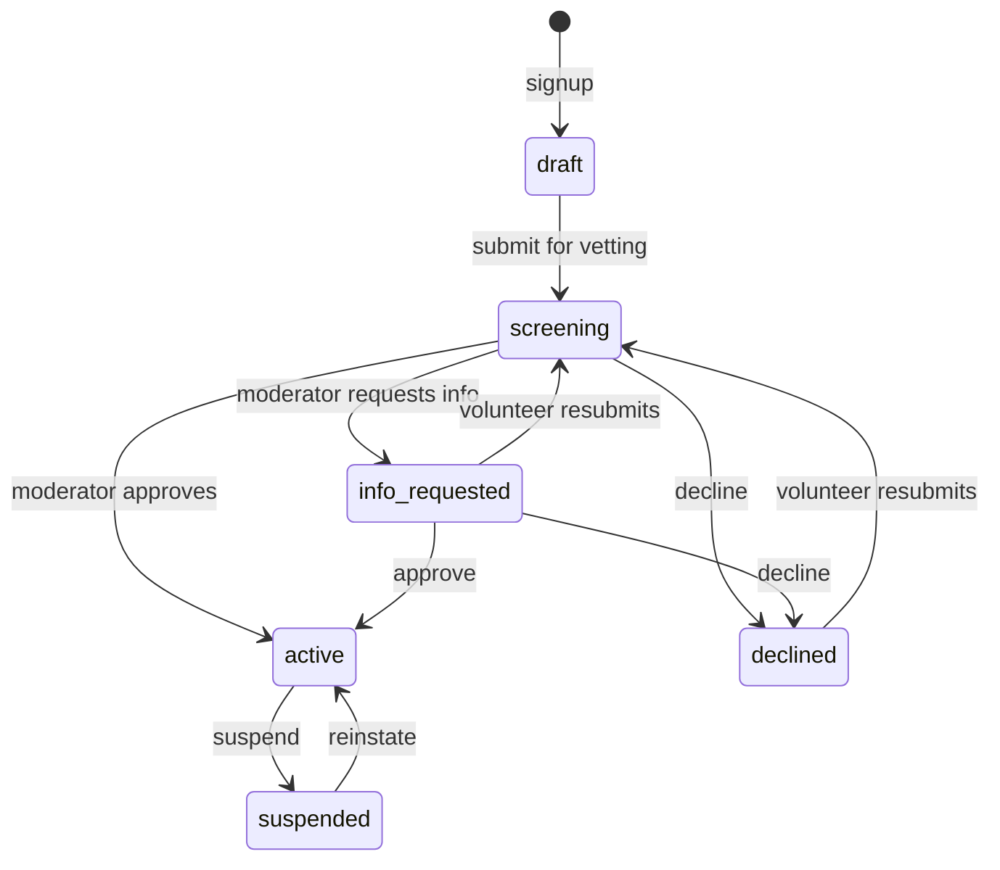

- Each transition writes a `vetting_events` row (with an optional private note), bumps
  `status_version`, notifies the volunteer and enqueues a volunteer projection.
- `VOLUNTEERS_WITH` edges exist in Relate **only while the status is active**, so an unvetted
  person can never appear in a match, however their profile looks.
- Submitting needs at least one offered skill. Moderators and admins are notified when someone
  enters screening (`notify_vetters`).

### 7.4 Volunteer onboarding, step 2: eligible to team

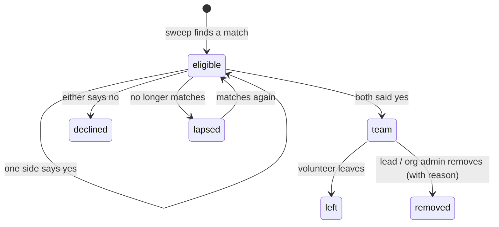

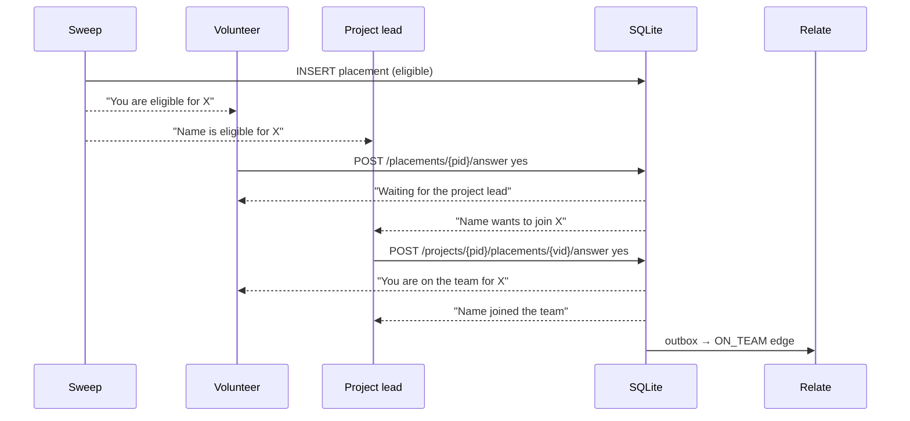

If the volunteer is the project's lead, the lead's yes is recorded automatically. Sweeps never
remove team members.

### 7.5 Project onboarding

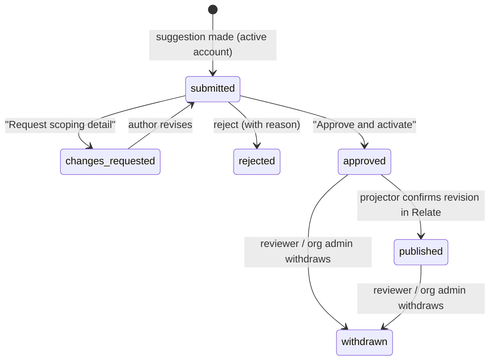

| State (DB) | Label shown | Visible for matching |
|---|---|---|
| `submitted` | In review | ✘ |
| `changes_requested` | Scoping: more detail requested | ✘ |
| `rejected` | Rejected | ✘ |
| `approved` | Approved (activating…) | ✘ (until projected) |
| `published` | **Active** | ✔ |
| `withdrawn` | Withdrawn | ✘ (projection removes it; placements end) |

The author is notified at every step, and the organisation's admins are told about new
suggestions. Decisions check the state, revision and version, so a replayed or stale form can't
publish twice.

### 7.6 Notifications

Every notification is written by `notify()` **inside the same transaction** as the change it
describes, so a user is never told about something that didn't happen. Clients read
`GET /notifications`, and the unread count is part of `GET /me`, shown as a badge on the web nav
and the mobile menu.

---

## 8. API surface

Interactive documentation: **`/api/docs`** (OpenAPI at `/api/openapi.json`). Errors are JSON:
422 invalid, 403 forbidden, 404 not found or not visible, 409 conflict or stale version, 503
graph busy.

| Tag | Endpoints |
|---|---|
| **auth** | `POST /auth/signup` · `POST /session` · `DELETE /session` |
| **me** | `GET /me` · `PUT /me/active-org` · `GET/PUT /profile` · `POST /me/vetting` · `GET /notifications` · `POST /notifications/{id}/read` · `POST /notifications/read-all` |
| **organisations** | `GET /orgs` · `PUT/DELETE /orgs/{org}/membership` · `GET /orgs/{org}/matches` · `GET /orgs/{org}/projects` · `GET /orgs/{org}/coverage` · `GET /orgs/{org}/volunteers` · `POST /orgs/{org}/volunteers/{uid}/remove` |
| **projects** | `GET/POST /submissions` · `GET /submissions/{sid}` · `POST /submissions/{sid}/revisions` · `GET /orgs/{org}/submissions` · `POST /orgs/{org}/submissions/{sid}/decision` · `POST /orgs/{org}/projects/{sid}/withdraw` · `PUT /orgs/{org}/projects/{sid}/lead` |
| **placements** | `GET /placements` · `POST /placements/{pid}/answer` · `POST /placements/{pid}/leave` · `GET /projects/{pid}/placements` · `POST /projects/{pid}/placements/{vid}/answer` · `POST /projects/{pid}/placements/{vid}/remove` |
| **moderation** | `GET /moderation/volunteers` · `GET /moderation/volunteers/{uid}` · `POST /moderation/volunteers/{uid}/decision` |
| **admin** | `GET /admin/users` · `PUT/DELETE /admin/users/{uid}/system-roles/{role}` · `PUT/DELETE /admin/orgs/{org}/roles/{uid}/{role}` · `POST /admin/orgs` · `GET /admin/projection` · `POST /admin/projection/replay` · `GET /admin/graph` |

All paths are prefixed with `/api/v1`.

### Client coverage

| Capability | Web | Mobile | Admin console |
|---|:-:|:-:|:-:|
| Sign in / sign up | ✔ | ✔ (sign in) | ✔ (staff) |
| Profile: onboarding card, skills by type, causes, active and past projects | ✔ | ✔ | |
| Matches and coverage | ✔ | ✔ | coverage |
| Suggest and revise projects | ✔ | ✔ | |
| Opportunities (answer offers, leave teams) | ✔ | ✔ | |
| Notifications | ✔ | ✔ | |
| Review queue, candidates and team, volunteers | ✔ | | ✔ |
| Volunteer screening | | | ✔ |
| Users, roles, organisations, projection, graph | | | ✔ |

The web and mobile profile pages share one structure from `profile_view.overview`: an
onboarding card, then accordions for Skills (with sub-accordions per skill type), Causes,
Active projects and Past projects.

---

## 9. Functions by module

### `auth.py`
`normalise_email`, `hash_password`, `token_hash`, `signup`, `authenticate`, `create_session`,
`load_session`, `revoke_session`, `set_active_org`, `csrf_matches`.

### `services.py`
- **Errors:** `NotFound`, `Forbidden`, `Conflict`, `Invalid`.
- **Access:** `Actor`, `load_actor`, `get_actor`, `Access`, `org_access`, `require_access`,
  `require_active`.
- **Organisations:** `directory`, `accessible_orgs`, `set_membership`, `org_volunteers`,
  `remove_volunteer`, `create_organisation`.
- **Vetting:** `submit_for_vetting`, `vetting_queue`, `vetting_record`, `vet_volunteer`.
- **Roles:** `set_system_role`, `set_org_role`, `list_users`.
- **Profile:** `get_profile`, `update_profile`.
- **Submissions:** `create_submission`, `revise_submission`, `get_submission`, `my_submissions`,
  `review_queue`, `review_submission`, `withdraw_project`, `set_project_lead`,
  `published_state`.

### `placements.py`
`sweep` (Relate matches to placements), `volunteer_respond`, `lead_respond`,
`end_team_membership`, `for_volunteer`, `for_project`.

### `matching.py`
`volunteer_matches`, `project_coverage`, `browse`, plus helpers that check for pending updates
and build explanations.

### `notify.py`
`notify`, `notify_org_admins`, `notify_vetters`, `list_for`, `unread_count`, `mark_read`.

### `profile_view.py`
`overview`: skills grouped by type, causes, and active and past projects with labels.

### `graph/`
- **`store.py`:** `GraphStore.write()`, `.reader()`, `.read()`; errors `GraphError`, `GraphBusy`,
  `GraphTruncated`.
- **`projector.py`:** `Projector.drain()`, `.status()`, the `on_projected` hook, `pending_for`.
- **`cypher.py`:** `MATCH_CANDIDATES`, `COVERAGE_GAPS`, `EXCLUDED_FOR_VOLUNTEER`,
  `OPTIONAL_SKILLS_EXCLUDED`, `BROWSE_PROJECTS`, `INSPECT`, and the reconcile statements.
- **`aura.py`:** `push` (scoped to `dvn-demo-v1`) and `parity`.

### `runtime.py` and `cli.py`
- **`runtime.py`:** `build_runtime`, `bootstrap`, `seed_catalogue`, `seed_demo` (which forms the
  team through the real accept flow), `reset_demo`.
- **`cli.py` commands:** `reset`, `bundle`, `inspect`, `matches`, `status`, `drain`,
  `grant-reviewer`, `aura-push`, `aura-parity`.

---

## 10. Deployment and operations

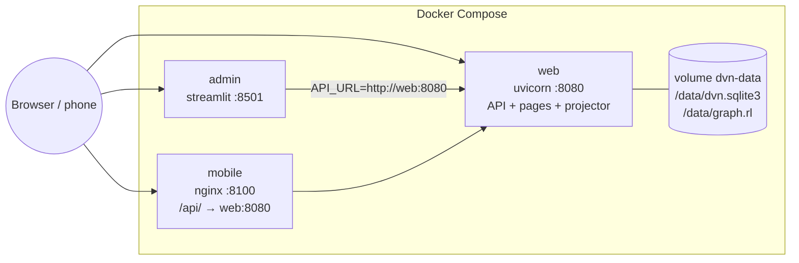

| Path | Commands |
|---|---|
| **Clean start with uv** | `uv sync --locked` → `uv run task reset` → `uv run task web` (+ `uv run task admin`) |
| **Clean start with Compose** | `docker compose up --build` (ports configurable with `WEB_PORT`, `ADMIN_PORT`, `MOBILE_PORT`) |
| **Reset demo** | `uv run task reset` or `docker compose down -v` |
| **Inspect graph** | `uv run task inspect`, `relate ...` on `var/graph.rl` |
| **Projection health** | `python -m app.cli status` / `drain`, or the console's *System* tab |
| **AuraDB** | `python -m app.cli aura-push` then `aura-parity` (needs `AURA_*` credentials) |

**Configuration** (env or `.env`): `DATA_DIR`, `ORG_NAMES`, `SESSION_TTL_HOURS`,
`COOKIE_SECURE`, `TRUST_PROXY_HEADERS`, `API_URL`, `PROJECTOR_INTERVAL_SECONDS`,
`SEED_DEMO_ON_START`, `GRAPH_MAX_ROWS`, `AURA_URI` / `AURA_USER` / `AURA_PASSWORD`, `APP_ENV`.

**Schema changes:** `PRAGMA user_version` must equal `SCHEMA_VERSION` (2), or the app stops with
a `SchemaOutdated` message pointing to the reset commands. The demo data is disposable, so there
are no migrations.

---

## 11. Quality and verification

| Check | Result |
|---|---|
| `ruff check` / `ruff format --check` | Clean, 54 files |
| `pytest` | **81 passed, 2 skipped** (AuraDB without credentials; Compose gated); 89% coverage |
| RBAC and onboarding suite | 15 tests (`tests/test_rbac_onboarding.py`) |
| Relate persistence | Write, close, reopen and assert (`tests/test_relate_store.py`) |
| Mobile | Lint OK, **25 tests**, production build OK |
| Admin console | `AppTest` as system admin, moderator and org admin: correct tabs, no exceptions |
| Compose | Built and smoke-tested on alternate ports; `/api/docs` returns 200 |
| Lockfile | `uv lock --check` OK |
| AuraDB | **Not verified**: no credentials available |

Details are in [verification.md](verification.md).

---

## 12. Architecture decisions

| # | Decision | Alternatives considered | Rationale |
|---|---|---|---|
| AD-1 | SQLite as the source of truth, Relate as a projected read model | Graph as the only store | Transactions, constraints and auditable history for identity and workflow; the graph stays PII-free |
| AD-2 | Transactional outbox with idempotent reconcile | Dual writes; change-data capture | No lost or partial updates; safe replay after a crash; order-independent |
| AD-3 | Withhold results while an update is pending | Show possibly stale matches | Prevents suggesting an excluded cause or a withdrawn project |
| AD-4 | Open Relate per unit of work with a lock and bounded retry | One long-lived connection | Relate's exclusive lock would block the CLI and inspection tools |
| AD-5 | Opaque, hashed sessions | JWT | Instant revocation; nothing to forge or leak from storage |
| AD-6 | Admin console and mobile app as pure API clients | Direct DB access | One authorisation path; the console holds no special privileges |
| AD-7 | 404 for projects and submissions a user can't see; 403 with a reason for refused organisation actions | 403 everywhere | Doesn't reveal hidden projects, and still tells members why an action was refused |
| AD-8 | Cypher in the Neo4j 5 dialect | Relate-specific syntax | Lets the same queries run on AuraDB for the parity check |
| AD-9 | AuraDB is explicit, off the request path | Live sync | Optional, credential-gated, no effect on the demo's availability |

---

## 13. Limitations and next steps

| Area | Current state | Next step |
|---|---|---|
| Notifications | In-app only | Email or push via a delivery worker reading the same table |
| Scale | Single process; Relate locks exclusively | A separate projector worker; read replicas or AuraDB for heavy reads |
| Web pages | Call services in-process | Optionally route them through the API as well |
| AuraDB | Push and parity built, not verified | Run with credentials and record parity output |
| Migrations | Reset on schema change | Add migrations before any real data |
| Mobile | Browser build served by nginx | Capacitor native builds, offline cache |
| Observability | Logs plus projection status | Metrics for outbox lag and Relate lock waits |
